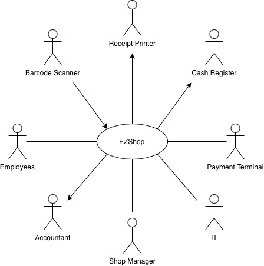
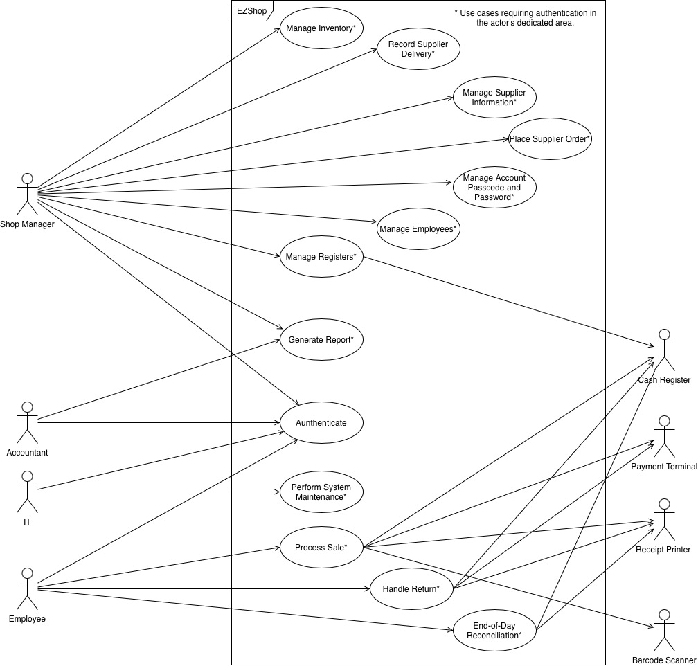
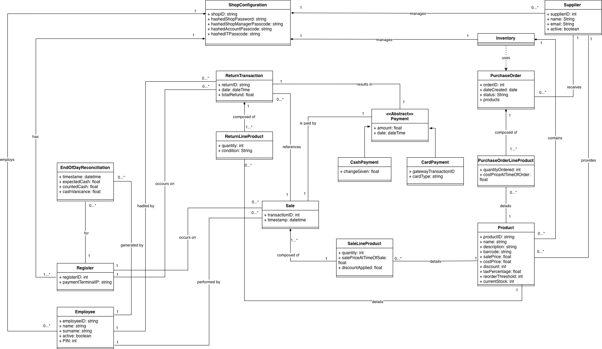
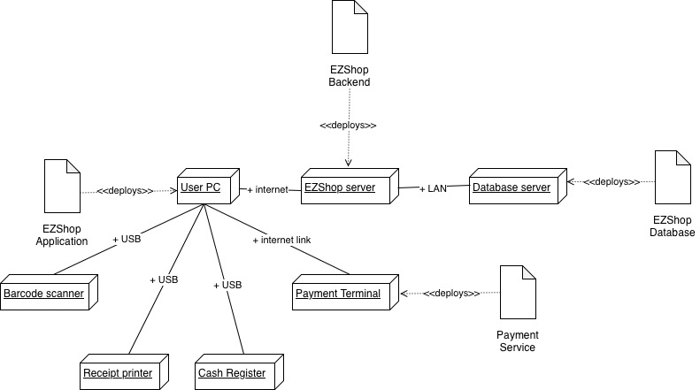

# Requirements Document - EZShop

Date: 24/10/2025

Version: 2.0.0

# Contents

- [Requirements Document - EzShop](#requirements-document)
- [Contents](#contents)
- [Informal Description](#informal-description)
- [Business Model](#business-model)
    - [Revenue Stream](#revenue-stream)
    - [Customer Segments](#customer-segments)
    - [Value Proposition](#value-proposition)
- [Stakeholders](#stakeholders)
- [Context Diagram and Interfaces](#context-diagram-and-interfaces)
    - [Context Diagram](#context-diagram)
    - [Interfaces](#interfaces)
- [Functional and Non Functional Requirements](#functional-and-non-functional-requirements)
    - [Functional Requirements](#functional-requirements)
    - [Non Functional Requirements](#non-functional-requirements)
- [Table of Rights](#table-of-rights)
- [Use Case Diagram and Use Cases](#use-case-diagram-and-use-cases)
    - [Use Case Brief](#use-case-brief)
    - [Use Case Diagram](#use-case-diagram)
    - [UC1 Authenticate](#uc1-authenticate)
        - [Scenario 1.1: Nominal scenario (Employee authenticates)](#scenario-11-nominal-scenario-employee-authenticates)
        - [Scenario 1.2: Shop Manager authenticates](#scenario-12-shop-manager-authenticates)
        - [Scenario 1.3: Accountant authenticates](#scenario-13-accountant-authenticates)
        - [Scenario 1.4: IT authenticates](#scenario-14-it-authenticates)
        - [Scenario 1.5: First time Shop Login](#scenario-15-first-time-shop-login)
        - [Scenario 1.6: Normal Shop Login](#scenario-16-normal-shop-login)
    - [UC2 Process Sale](#uc2-process-sale)
        - [Scenario 2.1: Nominal scenario (Cash Payment)](#scenario-21-nominal-scenario-cash-payment)
        - [Scenario 2.2: Credit/debit card payment](#scenario-22-creditdebit-card-payment)
        - [Scenario 2.3: Remove Product](#scenario-23-remove-Product)
        - [Scenario 2.4: Modify quantity](#scenario-24-modify-quantity)
        - [Scenario 2.5: Cancel Sale](#scenario-25-cancel-sale)
    - [UC3 Handle Return](#uc3-handle-return)
        - [Scenario 3.1: Nominal Scenario (Cash Refund)](#scenario-31-nominal-scenario-cash-refund)
        - [Scenario 3.2: Card Refund](#scenario-32-card-refund)
    - [UC4 End-of-Day Reconciliation](#uc4-end-of-day-reconciliation)
        - [Scenario 4.1: Nominal Scenario (Open Register)](#scenario-41-nominal-scenario-open-register)
        - [Scenario 4.2: Close Register](#scenario-42-close-register)
    - [UC5 Manage Products and Inventory](#uc5-manage-Products-and-inventory)
        - [Scenario 5.1: Nominal Scenario (Manage Product Definitions)](#scenario-51-nominal-scenario-manage-Product-definitions)
        - [Scenario 5.2: Adjust Stock quantity](#scenario-52-adjust-stock-quantity)
        - [Scenario 5.3: Record delivery](#scenario-53-record-delivery)
    - [UC6 Manage Supplier Information](#uc6-manage-Supplier-information)
        - [Scenario 6.1: Nominal Scenario (Create New Supplier)](#scenario-61-nominal-scenario-create-new-Supplier)
        - [Scenario 6.2: Update Supplier Information](#scenario-62-update-Supplier-information)
        - [Scenario 6.3: Deactivate Supplier](#scenario-63-deactivate-Supplier)
    - [UC7 Place Supplier Order](#uc7-place-Supplier-order)
        - [Scenario 7.1: Nominal Scenario (Create and Send PO)](#scenario-71-nominal-scenario-create-and-send-po)
        - [Scenario 7.2: Create and Save as Draft](#scenario-72-create-and-save-as-draft)
    - [UC8 Generate Report](#uc8-generate-report)
        - [Scenario 8.1: Nominal Scenario (Generate Inventory Valuation Report)](#scenario-81-nominal-scenario-generate-inventory-valuation-report)
        - [Scenario 8.2: Generate unfiltered sales report](#scenario-82-generate-unfiltered-sales-report)
        - [Scenario 8.3: Generate Sales Report filtered by Register ID](#scenario-83-generate-sales-report-filtered-by-register-id)
        - [Scenario 8.4: Generate sales report filtered by Employee ID](#scenario-84-generate-sales-report-filtered-by-employee-id)
        - [Scenario 8.5: Generate PO Report](#scenario-85-nominal-scenario-actor-generates-po-report)
    - [UC9 Manage Account Passcodes and Shop Password](#uc9-manage-account-passcodes-and-shop-password)
        - [Scenario 9.1: Nominal Scenario (Change Passcode/Password)](#scenario-91-nominal-scenario-change-passcodepassword)
    - [UC10 Manage Registers](#uc10-manage-registers)
        - [Scenario 10.1: Nominal scenario (Add Cash Register)](#scenario-101-nominal-scenario-add-cash-register)
        - [Scenario 10.2: Change Payment Terminal connected to a register](#scenario-102-change-payment-terminal-connected-to-a-register)
    - [UC11 Manage Employees](#uc11-manage-employees)
        - [Scenario 11.1: Nominal Scenario (Create new employee)](#scenario-111-nominal-scenario-create-new-employee)
        - [Scenario 11.2: Update Employee](#scenario-112-update-employee)
        - [Scenario 11.3: Deactivate Employee](#scenario-113-deactivate-employee)
    - [UC12 Perform System Maintenance](#uc12-perform-system-maintenance)
        - [Scenario 12.1: Nominal Scenario (View and Export Logs)](#scenario-121-nominal-scenario-view-and-export-logs)
        - [Scenario 12.2: Apply Software Update](#scenario-122-apply-software-update)
        - [Scenario 12.3: View System Diagnostics](#scenario-123-view-system-diagnostics)
- [Glossary](#glossary)
- [System Design](#system-design)
- [Hardware Software Architecture](#hardware-software-architecture)

# Informal Description

Small shops require a simple application to support the owner or manager. A small shop (ex a food shop) occupies 50-200 square meters, sells 500-2000 different item types, has two or a few more cash registers. 
EZShop is a software application to:
* manage sales
* manage inventory
* manage orders to Suppliers
* support accounting

In the following describe the requirements of the EZShop application. 
You are free to define the application as you deem more useful and effective for the stakeholders. 
You are also free to modify the structure of the document when needed.
The document will be evaluated considering the typical defects in requirements (omissions, ambiguities, contradictions, etc), and syntactic errors in the formalism used (UML diagrams). 
Consider that the document should be delivered to another team (unknown to you)
 which will be in charge of designing and implementing the system. The design team should be able to proceed only with the information in the document.

# Business Model
## Revenue Stream
EZShop generates revenue through licensing and service agreements with small retail shops. The shops pay to use the software as a tool for managing sales, inventory and accounting. The payment model is a  yearly subscription-based plan that includes software updates and technical support. The development team provides the software and ongoing maintenance as part of the paid service.

## Customer Segments
- Small physical shops that need an affordable and easy-to-use software application. 
- Store managers and employees who use EZShop to handle daily operations. 
- Accountants who benefit from integrated reporting features. 
- Suppliers, who receive restock orders manually initiated by the Shop Manager when the system signals low inventory. 

## Value Proposition
EZShop provides a simple and reliable software system tailored for small physical shops. It helps the cashier efficiently manage sales though a user-friendly interface, the Shop Manager to monitor inventory, receive low stock reports and generate Supplier orders directly through the system, the Accountant to automatically receive accurate financial data for tax reporting, and the Suppliers to get accurate restock orders. 
Overall, the system reduces administrative and time consuming task, minimize errors, and ensures smoother shop operations. 

# Stakeholders

| Stakeholder name | Description |
| :--------------: | :---------: |
|Shop Manager| Oversees the shop’s daily operations. Use EZShop to track sales, manage inventory, manage Supplier orders, and review performance reports. |
|Employees|Operate the register and handles customer sales. Use EZShop by logging in with a unique PIN to scan Products and process payments. |
|Accountant| Accesses the system’s financial reports for bookkeeping. |
|Customer| Purchases Products from the shop. Indirect stakeholder who benefits from efficient checkout. |
|Developer Team| Designs and implements the EZShop system. Responsible for ensuring that functional and non-functional requirements are met. |
|Suppliers| Provide goods to the shop. The Shop Manager contacts the Supplier when stock levels are low, based on EZShop’s low stock reports. Orders and stock updates are then recorded manually in the system by the Shop Manager. |
|IT| Provides technical support, maintenance and troubleshooting for the EZShop system.| 
|Barcode Scanner| Hardware device connected to the shop computer. Sends scanned Product barcodes to EZShop during a sale so the system can identify the Product.|
|Receipt Printer| Hardware device used to print sales receipts and end-of-day reconciliation.|
|Cash Register| Hardware device that holds cash and is opened during cash payments or during end-of-day operations. Triggered by EZShop after certain transactions.|
|Payment Terminal| External system that securely handles electronic payment transactions such as a credit/debit card payment.|

# Context Diagram and Interfaces

## Context Diagram

## Interfaces

|   Actor   | Logical Interface | Physical Interface |
| :-------: | :---------------: | :----------------: |
|Employees| POS area: login with Employee PIN, New Sale, Manage Returns, End-of-Day Reconciliation. | Shop computer with locally connected POS Hardware and Payment Terminal. 
|Shop Manager| Administration area: Manage Inventory, Manage Orders to Suppliers, Support Accounting, Manage Accounts & Registers, Manage Employees.| Shop computer in the store; Shop Manager logs in with Manager Passcode.|
|Accountant| Support Accounting module: generate/export sales, inventory, and purchase order reports.| Shop computer in the store; Accountant logs in with Accountant Passcode.|
|IT| Maintenance / configuration / software update access (non-business functions).| Admin workstation or remote maintenance connection.|
|Barcode Scanner| Sends scanned Product codes to the active sale so EZShop can add the correct Product.|USB device plugged into the shop computer|
|Receipt Printer| Receives print commands for sales receipts and end-of-day reconciliation receipts.| USB printer connected to the shop computer.|
|Cash Register| Opens on cash payments or at register close, and may receive total amounts.| Connected to the receipt printer or to the shop computer.|
|Payment Terminal| Payment authorization/refund API calls for card transactions.| Network/HTTPS connection from EZShop computer to external payment service.|

# Functional and Non Functional Requirements

## Functional Requirements

|  ID   | Description |
| :---: | :--------- |
|**FR1**| **Manage sales**|
|FR1.1| The system shall allow the employee to start a new sale transaction.|
|FR1.2| The system shall allow an employee to add a Product to the sale.|
|FR1.2.1| The system shall allow an employee to add a Product to the sale by scanning its barcode.|
|FR1.2.2| The system shall allow an employee to add a Product to the sale by manually searching for its name or Product ID. |
|FR1.3| The system shall allow to specify or modify the quantity of a Product in the sale.|
|FR1.4| The system shall allow an employee to remove a Product from the current sale.|
|FR1.5| The system shall automatically calculate and display the current subtotal, applying any discounts defined in the Product definition (FR2.3), and total taxes. |
|FR1.6| The system shall allow the employee to select a payment method (cash, credit card, debit card).|
|FR1.6.1| For cash payments, the system shall record the amount of cash received, trigger the Cash Register to open and automatically calculate the change due.|
|FR1.6.2| For credit/debit card payments, the system shall interface with the Payment Terminal (using the IP defined in FR10.2.1) to process the transaction and receive a confirmation or a denial (error message). The Cash Register shall remain closed. |
|FR1.7| After a successful payment, the system shall allow the employee to print a receipt via the register. |
|FR1.7.1| The receipt shall include the unique transaction ID, the date, the hour of the day, the list of the Products (including unit price and applied discount), total cost, total taxes, payment method, Register ID (FR10.2) and Employee ID (FR8.3).  |
|FR1.8| After a sale, the system shall automatically decrement the stock levels of the sold Products in the inventory. |
|FR1.9| The system shall allow the employee to cancel the sale transaction at any point before a payment is successfully processed.| 
|FR1.10| The system shall end the sale transaction either by a successful payment (FR1.7) or a cancellation (FR1.9).|
|**FR2**| **Manage inventory**|
|FR2.1| The system shall require the Manager Passcode to access all Manage Inventory functions. |
|FR2.2| The system shall allow the Shop Manager to create, update and deactivate a Product definition.  |
|FR2.3| A Product definition (FR2.2) must include: Product ID, Name, Description, Barcode, Sale price, Cost price, eventual Discount, Tax percentage, Supplier and a Reorder threshold.  |
|FR2.4| The system shall display a real-time list of all Products and their current stock quantities. |
|FR2.5| The system shall allow the Shop Manager to adjust the stock quantity of a Product with a given reason (spoilage, theft, count correction).|
|FR2.6| The system shall provide a function for the Shop Manager to record the reception of new stock, updating the inventory quantities.| 
|FR2.6.1| The system shall allow the Shop Manager to record new stock by:  - Linking it to an existing purchase order (fulfilling FR3.8) - Performing a manual adjustment (without a PO)|
|FR2.7| The system shall automatically add a Product to the ‘Low Stock Report’ when a Product’s stock quantity falls at or below its defined Reorder threshold (FR2.2).| 
|FR2.8| The system shall provide a function for the Shop Manager to change the Sale Price of a Product. |
|**FR3**| **Manage orders to Suppliers**|
|FR3.1| The system shall require the Manager Passcode to access all Manage Orders to Suppliers functions. |
|FR3.2| The system shall allow the Shop Manager to create, read, update and deactivate Supplier contact information. |
|FR3.3| The system shall allow the Shop Manager to create a new purchase order for a specific Supplier. |
|FR3.4| The system shall allow the Shop Manager to automatically populate the purchase order with Products from the ‘Low-Stock Report’ (FR2.7).|
|FR3.5| The system shall generate a PDF/CSV file of the Purchase Order. |
|FR3.6| The system shall allow the Shop Manager to send the generated Purchase Order (FR3.6) to the Supplier’s contact email (FR3.2) manually out of the application. |
|FR3.7| The system shall allow the Shop Manager to change the status of the purchase order (draft, sent, received, canceled). |
|FR3.8| The system shall link received purchase orders to the inventory update function (FR2.6).|
|**FR4**| **Support Accounting**|
|FR4.1| The system shall require the Manager Passcode or the Accountant Passcode to access all the Support Accounting functions. |
|FR4.2| The system shall allow the Accountant and the Shop Manager to generate different reports for a specified date range. |
|FR4.2.1| The system shall allow the Accountant and the Shop Manager to generate a sales report that must include total revenue, total taxes and total refunds. The system shall allow this report to be filtered by Register ID (FR10.2) and/or Employee ID (FR8.3).|
|FR4.2.2| The system shall allow the Accountant and the Shop Manager to generate an inventory valuation report, showing the current stock and its total value based on cost price (FR2.2). |
|FR4.2.3| The system shall allow the Accountant and the Shop Manager to generate an purchase order report listing all purchase orders (from FR3) within a date range, their status and their total cost.| 
|FR4.3| The system shall allow the Accountant and the Shop Manager to export all reports in a standard format (CSV). |
|**FR5**| **Authorize and authenticate**|
|FR5.1| The system shall require a unique Shop ID and a Shop Password to be entered to launch and use the application. These credentials will be securely given to the Shop Manager as part of the software installation. |
|FR5.1.1| Upon the first successful shop login (FR5.1), the system shall ask the Shop Manager to change the Shop Password (FR9.5) before granting access to other system functions. |
|FR5.1.1.1| When needed, the Shop Manager will share the credentials of the shop (Shop ID and Shop Password) to the Account and to the IT to let them access to their sections on their personal computers. 
|FR5.2| After successful shop login (FR5.1), the system shall present a role selection screen with two options: ‘Point Of Sale’ and ‘Administration’.|
|FR5.2.1| If ‘Point Of Sale’ is selected (FR5.2), the system shall require a 4-digit Employee PIN to access the POS Area.|
|FR5.2.1.1| The system shall validate the entered PIN against the employee database (FR8.3).|
|FR5.2.1.2| If the PIN is valid, the system shall then check if the associated employee account is active (FR8.2).|
|FR5.2.1.3| If the employee account is active, the system shall log in the associated employee and grant access to all functions in FR1(Manage Sales), FR6 (Manage Returns) and FR7 (Manage End-of-Day Reconciliation).|
|FR5.2.1.4| If the employee account is deactivated, the system shall display an error message and deny access.|
|FR5.2.1.5| All transactions initiated from this session shall be automatically associated with the employee’s Employee ID and the device’s unique Register ID (FR10.2). |
|FR5.2.2| If ‘Administration’ is selected (FR5.2), the system shall prompt a passcode.|
|FR5.2.2.1| The system shall define and securely store three separate passcodes: a Manager Passcode, an Accountant Passcode and an IT Passcode. |
|FR5.2.2.2| If the Manager Passcode is entered, the system shall grant access to all functions in FR2 (Manage Inventory), FR3 (Manage Orders) and FR4 (Support Accounting), FR8 (Manage Employees), FR9 (Manage Accounts), FR10 (Manage Registers).|
|FR5.2.2.3| If the Accountant Passcode is entered, the system shall grant access only to the functions in FR4 (Support Accounting).|
|FR5.2.2.4| If the IT Passcode is entered, the system shall grant access only to the functions in FR11 (System Maintenance).|
|FR5.3| The system shall provide in all areas (Manager Area, Accountant Area, Support Area, POS Area) a “Lock” function that logs out the current user and returns to the role selection screen. |
|FR5.4| The system shall provide a function to log the shop out of the application.|
|**FR6**| **Manage Returns**|
|FR6.1| The system shall allow an employee to initiate a return transaction. |
|FR6.2| The system shall require the employee to find the original sale by its unique transaction ID from the receipt (FR1.7.1).|
|FR6.2.1| If the customer doesn’t have a receipt, the system shall not allow the return. |
|FR6.3| The system shall allow the employee to select one or more Products from the original sale to be returned. |
|FR6.4| For every Product to be returned, the system shall require the employee to specify if the returned Product is re-sellable or damaged. |
|FR6.4.1| If the Product is re-sellable, the system shall automatically increment the Product’s stock quantity in the inventory (FR2).|
|FR6.5| The system shall calculate the total refund amount. |
|FR6.6| The system shall process the refund via the original payment method. |
|FR6.6.1| If the purchase was paid by credit/debit card, the system shall send a refund request to the payment terminal. |
|FR6.6.2| If the purchase was paid by cash, the system shall instruct the employee on the cash amount to return. |
|FR6.7| The system shall log the return transaction including the Employee ID (FR8.3), and it must be included in the accounting sales report (FR4.2.1).|
|**FR7**| **Manage End-of-Day Reconciliation**|
|FR7.1| The system shall have a function called “Open Register” that requires the employee to enter the starting cash amount.|
|FR7.2| The system shall have a function called “Close Register” that calculates and displays the days expected totals (total cash, total card, total cash refunds, total card refunds). |
|FR7.2.1| When closing the register, the system shall require the employee to enter the actual counted cash from the drawer.|
|FR7.2.2| The system shall then calculate and display the cash variance (the difference between the expected cash and the counted cash).|
|FR7.2.3| The system shall print a special receipt including these informations: Register ID (FR10.2), Employee ID (FR8.3), Total cash, Total card, Total refunds and Cash variance. |
|**FR8**| **Manage Employees**|
|FR8.1| The system shall require the Manager Passcode to access all Manage Employees functions in the Manager Area. |
|FR8.2| The system shall allow the Shop Manager to create, update and deactivate an employee account. |
|FR8.2.1| A deactivated employee account shall be retained in the system for all historical data. |
|FR8.3| An employee account must include: a unique Employee ID automatically generated by the application, a Name, a Surname and a 4-digit PIN.|
|FR8.4| The system shall allow the Shop Manager to update Name, Surname and 4-Digit PIN for any employee. |
|**FR9**| **Manage Account Passcodes and Shop Password**|
|FR9.1| The system shall require the Manager Passcode to access all Manage System Accounts functions. |
|FR9.2| The system shall include within the Manager Area a function to change the Manager Passcode. |
|FR9.3| The system shall include within the Manager Area a function to change the Accountant Passcode. |
|FR9.4| The system shall include within the Manager Area a function to change the IT Passcode. |
|FR9.5| The system shall include within the Manager Area a function to change the Shop Password. |
|**FR10** | **Manage Registers**|
|FR10.1| The system shall require the Manager Passcode to access all Manage Registers functions. |
|FR10.2| The system shall allow the Shop Manager to register a new register, which assigns it a unique Register ID that is stored locally on the register and on the system. When a register is connected to a computer in the shop, the computer recognizes the register via Register ID. |
|FR10.2.1| The system shall allow the Shop Manager to associate a Register ID with a specific Payment Terminal Identifier (IP address).|
|FR10.3| The Shop Manager shall be able to view a list of all registered registers. |
|FR10.4| The system shall allow the Shop Manager to update the Payment Terminal Identifier for an existing register. |
|**FR11**| **Perform System Maintenance**|
|FR11.1| The system shall require the IT Passcode to access all System Maintenance functions.|
|FR11.2| The System Maintenance Section shall provide a function to view and export system and error logs for troubleshooting.|
|FR11.3| The System Maintenance section shall provide a function to apply software updates.|
|FR11.4| The system shall provide a function to view detailed system diagnostics.|

## Non Functional Requirements

|   ID    | Type | Description | Refers to |
| :-----: | :--------------------------------: | :---------: | :-------: |
|NFR1| Security - Data Storage | All passwords, passcodes and Employee PINs shall be stored in a securely encrypted format.|FR5.1  FR5.2.2.1 FR8.3|
|NFR2| Security - Payment data | The system shall not store any sensitive cardholder data. All payment processing must be handled by the external payment terminal. | FR1.6.2 FR6.6.1|
|NFR3| Security - Session timeout |The system shall automatically lock the “Administration” modules automatically after 10 minutes of user inactivity. |FR5.2.2 FR5.3|
|NFR4| Efficiency - Barcode scan |The system shall add a Product to the sale within 1 second of a successful barcode scan. |FR1.2.1|
|NFR5| Efficiency - Product search |The system shall return manual Product search results within 2 seconds. |FR1.2.2|
|NFR6| Efficiency - Payment processing |The system shall send a payment request and receive response from the payment terminal within 3 seconds (excluding the terminal’s own processing time).| FR1.6.2 FR6.6.1|
|NFR7| Efficiency - Report generation| All accounting reports shall be generated within 10 seconds for a full year’s worth of data. | FR4.2 FR4.2.1 FR4.2.2 FR4.2.3|
|NFR8| Efficiency - Concurrency |The system must support at least 3 registers processing sales (FR1) and returns (FR6) simultaneously without any noticeable performance degradation. |FR1 FR6 FR10.2|
|NFR9| Availability |The system shall be available 99.9% of the time during defined shop business hours (8.7 hours of downtime per year). | All FRs|
|NFR10| Usability - Employee learnability| An untrained employee shall be able to perform a complete sale transaction with less than 15 minutes of training. | FR1  FR6|
|NFR11| Usability - Error messages| All user-facing error messages shall be in plain, non-technical language. |All FRs|
|NFR12| Usability - Interface type |The Point Of Sale interface shall be optimized for a touch-screen environment. |FR1   FR6   FR7|
|NFR13| Portability - Hardware: Barcode scanners| The system shall be compatible with any standard USB barcode scanner. | FR1.2.1|
|NFR14| Portability - Hardware: Printers |The system shall be compatible with any standard USB receipt printer. |FR1.7   FR7.2.3|
|NFR15 |Portability - OS compatibility |The EZShop application shall be installable and runnable on Windows, MacOS and Linux. |FR1   FR6  FR5.2.1|
|NFR16| Reliability - Data Integrity |The system’s central database shall be backed up automatically at least daily and backups shall be retained for at least 30 days.| All FRs|

# Table of Rights

| Actor | FR1 | FR2 | FR3 | FR4 | FR5 | FR6 | FR7 | FR8 | FR9 | FR10 | FR11 |
| :----: | :---: | :---: | :---: | :---: | :---: | :---: | :---: | :---: | :---: | :---: | :---: |
|Employees| Yes (PIN) |No |No |No |No |Yes (PIN) |Yes (PIN) |No |No |No |No|
|Shop Manager |No |Yes (Passcode) |Yes (Passcode) |Yes (Passcode) |Yes (Passcode) |No |No |Yes (Passcode) |Yes (Passcode) |Yes (Passcode) |No|
|Accountant |No |No |No |Yes (Passcode) |Yes (Passcode) |No |No |No |No |No |No|
|IT | |No |No |No |No |Yes (Passcode) |No |No |No |No |No |Yes (Passcode)|

# Use Case Diagram and Use Cases

## Use Case Brief
|  UC ID | UC name   | Goal | Main actor(s) | Supporting Actor(s) |
| :---: | :---: | :---: | :---: | :---: |
|UC1| Authenticate | Log into the system with role-based permissions. | Employee, Shop Manager, Accountant, IT | |
|UC2| Process Sale | Record a sale, update stock, and print a receipt. | Employee | Payment Terminal, Barcode Scanner, Receipt Printer, Cash Register|
|UC3 | Handle return | Process a refund for a prior sale and update inventory. | Employee | Receipt Printer, Payment Terminal, Cash Register|
|UC4| End-of-Day Reconciliation | Reconcile daily totals, calculate variance, and print a summary receipt. | Employee | Cash Register, Receipt Printer|
|UC5| Manage Inventory | Update Product definitions, adjust stock quantities, or record Supplier deliveries. | Shop Manager| |
|UC6| Manage Supplier Information | Create, update, or deactivate Supplier contact information.| Shop Manager | |
|UC7| Place Supplier Order | Create a purchase order and save it with a "Draft" or "Sent" status. | Shop Manager | |
|UC8| Generate PO Report | Generate and export a sales, inventory, or purchase order report. | Shop Manager, Accountant | |
|UC9| Manage Account Passcodes | Change a system Password or Pascode. | Shop Manager | |
|UC10| Manage Registers |Register a new register and assign it a unique Register ID and input the Payment Terminal ID. | Shop Manager | Cash Register |
|UC11| Manage Employees | Create, update, or deactivate an employee account. | Shop Manager | |
|UC12| Perform System Maintenance| View logs, apply updates, or run diagnostics. | IT | |

## Use Case Diagram

### UC1 Authenticate

| Item | Description |
| :--- | :--- |
| **Actors Involved** | Employee, Shop Manager, Accountant, IT |
| **Precondition** | The EZShop application is launched. |
| **Post condition** | A user is successfully logged into their respective module (POS or Administration) with the correct, role-based permissions. |
| **Nominal Scenario** | The system shows the role selection screen. The employee selects the role POS and authenticates with the appropriate PIN. The system validates the employee PIN, checks if the account is active, and shows POS main screen with sections: New Sale, Manage Returns and Manage End-of-Day Reconciliation. |
| **Variants** | Shop Manager authenticates (Scenario 1.2), Accountant authenticates (Scenario 1.3), IT authenticates (Scenario 1.4), First-time Shop login (Scenario 1.5), Normal Shop login (Scenario 1.6) |
| **Exceptions** | **Invalid Shop ID or Shop Password:** System displays "Invalid Shop ID or Password." and remains on the Shop Login screen. **Invalid Administration Passcode:** (applies to Manager, Accountant, or IT Passcodes) System displays "Invalid Passcode" and returns the user to the passcode entry screen. **Invalid Employee PIN:** System displays "Invalid PIN" and returns the user to the PIN entry screen. **Employee account is not active:** The PIN is valid, but the account is inactive. System displays "Account is deactivated. Please contact your Shop Manager." and returns to the role selection screen. |

#### Scenario 1.1: Nominal scenario (Employee authenticates)

| Scenario 1.1 |  |
| :--- | :--- |
| **Precondition** | Shop Manager has already launched the app with the Shop ID and the Shop Password. App shows role selection screen. (Scenario 1.5) |
| **Post condition** | Employee successfully logged in into POS Area. |

| Actor’s action (Employee) | System action | FR needed |
| :--- | :--- | :--- |
| Selects POS and authenticates with the 4 digits PIN | Validates the employee PIN against the database | FR5.2.1, FR5.2.1.1 |
| | Checks if the employee account is active | FR5.2.1.2 |
| | Shows POS main screen with sections: New Sale, Manage Returns and Manage End-of-Day Reconciliation. | FR5.2.1.3 |

#### Scenario 1.2: Shop Manager authenticates

| Scenario 1.2 |  |
| :--- | :--- |
| **Precondition** | Shop Manager has already launched the app with the Shop ID and the Shop Password. App shows role selection screen. (Scenario 1.5) |
| **Post condition** | Shop Manager successfully logged into the Manager Area. |

| Actor’s action (Shop Manager) | System action | FR needed |
| :--- | :--- | :--- |
| Selects the role ‘Administration’ and authenticates with appropriate Manager Passcode | Validates the Manager Passcode | FR5.2.2 |
| | Shows ‘Administration’ main screen with sections: Manage Inventory, Manage Orders, Support Accounting, Manage Accounts and Manage Registers | FR5.2.2.2 |

#### Scenario 1.3: Accountant authenticates

| Scenario 1.3 |  |
| :--- | :--- |
| **Precondition** | Accountant has launched the app. |
| **Post condition** | Accountant successfully logged into the Accountant Area (limited view). |

| Actor’s action (Accountant) | System action | FR needed |
| :--- | :--- | :--- |
| Logs into EZShop with Shop ID + Shop Password | Validates the Shop Password | FR5.1 |
| | Shows the role selection screen | FR5.2 |
| Selects the role Administration and authenticates with appropriate Accountant Passcode | Validates the Accountant Passcode | FR5.2.2 |
| | Shows ‘Administration’ main screen with access only to: Support Accounting | FR5.2.2.3 |

#### Scenario 1.4: IT authenticates

| Scenario 1.4 |  |
| :--- | :--- |
| **Precondition** | IT has launched the app. |
| **Post condition** | IT successfully logged into the Support Area (limited view). |

| Actor’s action (IT) | System action | FR needed |
| :--- | :--- | :--- |
| Logs into EZShop with Shop ID and Shop Password. | Validates the Shop Password | FR5.1 |
| | Shows the role selection screen | FR5.2 |
| Selects the role Administration and authenticates with appropriate IT Passcode | Validates the IT Passcode | FR5.2.2 |
| | Shows ‘Administration’ main screen with access only to: System Maintenance | FR5.2.2.4 |

#### Scenario 1.5: First time Shop Login

| Scenario 1.5 |  |
| :--- | :--- |
| **Precondition** | App is launched for the first time; Shop Manager has initial Shop ID and Shop Password. |
| **Post condition** | The Shop Password is changed and the system is at the role selection screen. |

| Actor’s action (Shop Manager) | System action | FR needed |
| :--- | :--- | :--- |
| Logs into EZShop with Shop ID + initial Shop Password | Validates the Shop Password | FR5.1 |
| | Detects it is the first log in and immediately prompts the Shop Manager to change the Shop Password | |
| Enters a new Shop Password and confirms it | Validates the new Shop Password and securely stores it | FR5.1.1, FR9.5 |
| | Shows the role selection screen | FR5.2 |

#### Scenario 1.6: Normal Shop Login

| Senario 1.6 |  |
| :--- | :--- |
| **Precondition** | App is launched. |
| **Post condition** | The Shop Password is changed and the system is at the role selection screen. |

| Actor’s action (Shop Manager) | System action | FR needed |
| :--- | :--- | :--- |
| Logs into EZShop with Shop ID and Shop Password | Validates the Shop Password. | FR5.1 |
| | Shows the role selection screen. | FR5.2 |

---

### UC2 Process Sale

| Actors Involved | Employee, Payment Terminal, Barcode Scanner, Receipt Printer, Cash Register |
| :--- | :--- |
| **Precondition** | Employee is logged into the POS Area. All hardware is working. Cash register is open. |
| **Post condition** | The sale is recorded, the stock levels of sold Products are decremented and a receipt is printed. The sale transaction has ended. |
| **Nominal Scenario** | The employee starts a new sale. Products are added by scanning their barcodes or by manually searching their name or Product ID. The system calculates the total. The employee selects a payment method and the customer pays by cash. The system processes the payment, prints the receipt, and automatically decrements inventory stock. |
| **Variants** | Payment is made via credit/debit card. (Scenario 2.2), The employee removes one or more Products (before payment). (Scenario 2.3), The employee modifies the quantity of a Product. (Scenario 2.4), The employee cancels the sale transaction (before payment). (Scenario 2.5), Product quantity falls below reorder threshold; the system adds the Product to “Low Stock Report”. (Scenario 2.6) |
| **Exceptions** | **Payment Terminal not working**: System displays an error message and returns the user to the payment selection screen. The sale is not canceled. **Product not found**: System displays an error message and keeps the user on the main sale screen to continue adding other items or try the search again.  **Receipt printer not working**: The sale is successful and is not voided. System displays an error message after payment. The system should allow the employee to continue to the next sale.  **Payment is denied**: System displays the denial message and returns the user to the payment selection screen to try a different method. The sale is not canceled.  **Cash register is closed**: System displays an error message. |

#### Scenario 2.1: Nominal scenario (Cash Payment)

| Scenario 2.1 | |
| :--- | :--- |
| **Precondition** | Employee logged into POS, section New Sale. Cash register in use is open. |
| **Post condition** | Stock levels updates, receipt printed. System ready for a new sale. |

| Actor’s action (Employee) | System action | FR needed |
| :--- | :--- | :--- |
| Starts a new sale transaction. | | FR1.1 |
| Scans a Product barcode with the Barcode Scanner. | Adds Product to sale, Calculates and displays subtotal and taxes. | FR1.2.1, FR1.5 |
| Adds another Product by manually searching for its name or Product ID. | Finds and adds Product to the sale, Calculates and displays subtotal and taxes. | FR1.2.2, FR1.5 |
| Repeats step 2 or 3 for all remaining Products. | System updates total for each Product | FR1.2.1, FR1.5 |
| Selects “Cash” as payment method and enters cash received in the Cash Register. | Records cash received and calculates the change due. | FR1.6, FR1.6.1 |
| | Prints a receipt via the receipt printer. | FR1.7, FR1.7.1 |
| | Decrements the stock levels of the sold Products in inventory, Ends sale transaction | FR1.8, FR1.10 |

#### Scenario 2.2: Credit/debit card payment

| Scenario 2.2 |  |
| :--- | :--- |
| **Precondition** | Employee logged into POS, section New Sale. Cash register in use is open. |
| **Post condition** | Stock levels updates, receipt printed. System ready for a new sale. |

| Actor’s action (Employee) | System action | FR needed |
| :--- | :--- | :--- |
| Starts a new sale transaction. | | FR1.1 |
| Scans a Product barcode with the Barcode Scanner. | Adds Product to sale, Calculates and displays subtotal and taxes. | FR1.2.1, FR1.5 |
| Adds another Product by manually searching for its name or Product ID. | Finds and adds Product to the sale, Calculates and displays subtotal and taxes. | FR1.2.2, FR1.5 |
| Repeats step 2 or 3 for all remaining Products. | System updates total for each Product | FR1.2.1, FR1.5 |
| Selects “Credit Card” or “Debit Card” as payment method | Interfaces with the Payment Terminal to process the transaction. | FR1.6, FR1.6.2 |
| | Prints a receipt via the receipt printer. | FR1.7, FR1.7.1 |
| | Decrements the stock levels of the sold Products in inventory, Ends sale transaction | FR1.8, FR1.10 |

#### Scenario 2.3: Remove Product

| Scenario 2.3 | |
| :--- | :--- |
| **Precondition** | Employee logged into POS. Sale in progress with Products. Cash register in use is open. |
| **Post condition** | Stock levels updated, receipt printed. System ready for a new sale. |

| Actor’s action (Employee) | System action | FR needed |
| :--- | :--- | :--- |
| Starts a new sale transaction and adds Products | System displays Products, current subtotal and current taxes. | FR1.1, FR1.2, FR1.5 |
| Selects a Product from the list. | Removes the Product from the current sale , Recalculates current subtotal and current taxes | FR1.4, FR1.5 |
| Selects a payment method (Cash or Card) | Processes payment (as in scenario 2.1 or 2.2), Prints a receipt , Decrements stock for remaining Products. , Ends the sale transaction | FR1.6, FR1.7, FR1.8, FR1.10 |

#### Scenario 2.4: Modify quantity

| Scenario 2.4 |  |
| :--- | :--- |
| **Precondition** | Employee logged into POS. Sale in progress with Products. Cash register in use is open. |
| **Post condition** | Stock levels updated, receipt printed. System ready for a new sale. |

| Actor’s action (Employee) | System action | FR needed |
| :--- | :--- | :--- |
| Starts a new sale transaction and adds Products | System displays Products, current subtotal and current taxes. | FR1.1, FR1.2, FR1.5 |
| Selects a Product from the list and modifies the quantity. | Updates the quantity for tat Product. , Recalculates current subtotal and current taxes | FR1.3, FR1.5 |
| Selects a payment method (Cash or Card) | Processes payment (as in scenario 2.1 or 2.2), Prints a receipt , Decrements stock for remaining Products. , Ends the sale transaction | FR1.6, FR1.7, FR1.8, FR1.10 |

#### Scenario 2.5: Cancel Sale

| Scenario 2.5 |  |
| :--- | :--- |
| **Precondition** | Employee logged into POS. Sale in progress, before payment. Cash register in use is open. |
| **Post condition** | Sale is discarded. No stock changed. System ready for a new sale. |

| Actor’s action (Employee) | System action | FR needed |
| :--- | :--- | :--- |
| Starts a new sale transaction and adds Products | System displays Products, current subtotal and current taxes. | FR1.1, FR1.2, FR1.5 |
| Selects “Cancel Sale”. | Discards the current transaction , Does not change the stock , Ends the sale transaction | FR1.9, FR1.10 |

---

### UC3 Handle Return
| Actors Involved | Employee, Receipt Printer, Payment Terminal. |
| :--- | :--- |
| **Precondition** | Employee is logged into the POS Area in the “Manage Returns” section. All hardware is working. |
| **Post condition** | Return transaction is created, refund is executed via the original payment method, inventory is updated for re-sellable Products, and the return is logged. |
| **Nominal Scenario** | The employee searches for the original sale by its transaction ID. The system shows the list of Products. The employee selects one or more Products to return. For each Product, the employee marks whether it is re-sellable or damaged. The system calculates the total refund. The system processes the refund via the original payment method (cash in this case), updates stock for re-sellable items, and logs the return. |
| **Variants** | Card Refund (Scenario 3.2) |
| **Exceptions** | **Customer cannot provide the original receipt**: System does not allow the return to proceed. **Payment Terminal not available (for card refund)**: System displays an error message. The return transaction is not completed and must be tried again later. **System fails to update inventory**: System displays an error message. The refund is not processed and the transaction is rolled back to prevent data inconsistency. The event is logged for IT/Manager review. |

#### Scenario 3.1: Nominal Scenario (Cash Refund)

| Scenario 3.1 | |
| :--- | :--- |
| **Precondition** | Employee logged into POS, “Manage Returns” section. |
| **Post condition** | Return recorded, Stock incremented, cash refunded. |

| Actor’s action (Employee) | System action | FR needed |
| :--- | :--- | :--- |
| Employee selects “New return”. | System asks for Transaction ID. | FR6.1 |
| Employee enters transaction ID from the original receipt. | System retrieves original sale and lists all Products. | FR6.2 |
| Employee selects Product to be returned (e.g. Product A and Product B). | | FR6.3 |
| Employee marks Product A as “re-sellable”. | System adds Product A to refund total. | FR6.4 |
| Employee marks Product B as “damaged”. | System adds Product B to refund total. | FR6.4, FR6.5 |
| Employee confirms the return. | System detects original payment was “Cash”. | FR6.6 |
| | System instructs employee on the cash amount to return. | FR6.6.2 |
| | System increments stock for Product A only, because it was marked as “resellable” | FR6.4.1 |
| | System logs the return in sales report. | FR6.7 |

#### Scenario 3.2: Card Refund

| Scenario 3.2 | |
| :--- | :--- |
| **Precondition** | Employee logged into POS, “Manage Returns” section. |
| **Post condition** | Return recorded, Stock incremented, refund request sent to Payment Terminal. |

| Actor’s action (Employee) | System action | FR needed |
| :--- | :--- | :--- |
| Employee selects “New return”. | System asks for Transaction ID. | FR6.1 |
| Employee enters transaction ID from the original receipt. | System retrieves original sale and lists all Products. | FR6.2 |
| Employee selects Product to be returned (e.g. Product A and Product B). | | FR6.3 |
| Employee marks Product A as “re-sellable”. | System adds Product A to refund total. | FR6.4 |
| Employee marks Product B as “damaged”. | System adds Product B to refund total. | FR6.4, FR6.5 |
| Employee confirms the return. | System detects original payment was “Card”. | FR6.6 |
| | System sends refund request to Payment Terminal. | FR6.6.1 |
| | System increments stock for Product A only, because it was marked as “resellable” | FR6.4.1 |
| | System logs the return in sales report. | FR6.7 |

---

### UC4 End-of-Day Reconciliation

| Actors Involved | Employee, Cash Register, Receipt Printer. |
| :--- | :--- |
| **Precondition** | Employee is logged into the POS Area in the “End-of-Day Reconciliation” section. |
| **Post condition** | End-of-day totals calculated, variance displayed, special reconciliation receipt printed. |
| **Nominal Scenario** | In the morning, the employee selects “Open Register” and enters the starting cash amount. |
| **Variants** | Close Register: at the end of the day, the employee selects “Close Register”. The system calculates expected totals. The employee counts the cash and enters the actual amount. The system calculates the variance and prints a reconciliation receipt. (Scenario 4.2) |
| **Exceptions** | **Register is already open**: (Employee tries to run “Open Register” twice) System does not allow the Employee to press “Open Register” button. **Register is not open**: (Employee tries to run “Close Register” before “Open Register”) System does not allow the Employee to press “Close Register” button. **Printer error**: (When closing). The close-out is saves. System displays an error message and allows the employee to log out. |

#### Scenario 4.1: Nominal Scenario (Open Register)

| Scenario 4.1 | |
| :--- | :--- |
| **Precondition** | Employee logged into POS, “Manage End-of-Day Close” section. The Cash Register is currently “Close”. |
| **Post condition** | Cash Register is marked as “Open” with a recorded starting cash amount. |

| Actor’s action (Employee) | System action | FR needed |
| :--- | :--- | :--- |
| Employee selects “Open Register”. | System prompts for starting cash amount. | FR7.1 |
| Employee counts the cash in the drawer and enters the amount. | | FR7.1 |
| Employee confirms | System records x€ as the starting cash and marks the register as “Open” for transactions | FR7.1 |

#### Scenario 4.2: Close Register

| Scenario 4.2 | |
| :--- | :--- |
| **Precondition** | Employee logged into POS, “Manage End-of-Day Close” section. The Cash Register is currently “Open”. |
| **Post condition** | Cash Register is marked as “Open” with a recorded starting cash amount. |

| Actor’s action (Employee) | System action | FR needed |
| :--- | :--- | :--- |
| Employee selects “Close Register”. | System calculates expected totals (cash, card, refunds) based on transactions since the “Open” event. | FR7.2 |
| Employee counts the cash in the drawer and enters the amount. | System calculates the cash variance (counted cash vs. expected cash) | FR7.2.1, FR7.2.2 |
| Employee confirms | System prints a special receipt with Register ID, Employee ID, totals and variance. | FR7.2.3 |

---

### UC5 Manage Products and Inventory

| Actors Involved | Shop Manager |
| :--- | :--- |
| **Precondition** | Shop Manager is logged into “Administration”. |
| **Post condition** | A Product's definition is created, updated or deactivated. |
| **Nominal Scenario** | The Shop Manager accesses the “Manage Products” section. The system displays the Product list. From here, the Shop Manager decides which inventory action to perform: Add a new Product, editing an existing Product. |
| **Variants** | Adjust the stock level. (Scenario 5.2), Record Supplier Delivery. (Scenario 5.3) |
| **Exceptions** | **Mandatory field missing**: System prevents saving and displays an error message highlighting the required field. **Duplicate Product ID or Barcode**: System prevents saving a displays an error message. |

#### Scenario 5.1: Nominal Scenario (Manage Product Definitions)

| Scenario 5.1 | |
| :--- | :--- |
| **Precondition** | Shop Manager logged into “Administration”, “Manage Products” section. |
| **Post condition** | Product definition is created, updated, or deactivated. |

| Actor’s action (Shop Manager) | System action | FR needed |
| :--- | :--- | :--- |
| Shop Manager clicks “New Product” or selects an existing Product and clicks “Edit” or “Deacivate”/”Activate”. | System shows the Product form. | FR2.2 |
| If creating/editing the Shop Manager fills/changes the attributes: Product ID, Name, Description, Barcode, Sale price, Cost price, Discount, Tax percentage, Supplier, Reorder threshold. | System validates mandatory fields. | FR2.3, FR2.8 |
| Shop Manager confirms. | System saves the changes to the Product definition. | FR2.2 |

#### Scenario 5.2: Adjust Stock quantity

| Scenario 5.2 | |
| :--- | :--- |
| **Precondition** | Shop Manager logged into “Administration”, “Manage Inventory” section. Product list is visible with current stock is visible. |
| **Post condition** | Inventory quantity is updated and the reason is logged. |

| Actor’s action (Shop Manager) | System action | FR needed |
| :--- | :--- | :--- |
| Shop Manager selects Product from list. | System shows Product details and current stock. | FR2.4 |
| Shop Manager selects “Adjust stock”. | System shows adjustment form. | FR2.5 |
| Manager enters the new total quantity. | | FR2.5 |
| Manager writes a reason. | System validated the new quantity is not negative. | FR2.5 |
| Manager confirms | System updates the Product’s stock quantity and logs the reason for the change in section "Adjustment History”. | FR2.5 |

#### Scenario 5.3: Record delivery

| Scenario 5.3 | |
| :--- | :--- |
| **Precondition** | Supplier has delivered all Products. |
| **Post condition** | Inventory quantities are increased. If PO delivery, the PO status may be updated. |

| Actor’s action (Shop Manager) | System action | FR needed |
| :--- | :--- | :--- |
| Manager selects “Record Supplier delivery”. | System shows list of open POs (status “Sent”) or an option for manual delivery. | FR2.6 |
| If PO delivery: Shop Manager selects the PO, verifies quantities and confirms. | System updates inventory for all Products in the PO. System updates the PO status to “Received”. | FR2.6, FR3.7, FR3.8 |
| If Manual delivery: Shop Manager selects “Record Manual Delivery”, finds Products and enters received quantities. | System updates inventory for all Products and quantities in the list. | FR2.6, FR2.6.1 |

---

### UC6 Manage Supplier Information

| Actors Involved | Shop Manager. |
| :--- | :--- |
| **Precondition** | Shop Manager is logged into “Administration” in the “Manage Orders” section. |
| **Post condition** | Supplier information (name, contact, email, phone) is created in the system. (FR3.2) |
| **Nominal Scenario** | The Shop Manager selects "Manage Suppliers." The system displays a list of all current Suppliers. The Shop Manager then chooses to create a new Supplier. The Shop Manager enters the new Supplier's details and saves. |
| **Variants** | Update existing Supplier information. (Scenario 6.2), Deactivate a Supplier. (Scenario 6.3) |
| **Exceptions** | **Mandatory field missing**: System prevents saving and displays an error message. **Supplier in use**: System prevents deactivation and displays an error message. |

#### Scenario 6.1: Nominal Scenario (Create New Supplier)

| Scenario 6.1 | |
| :--- | :--- |
| **Precondition** | Shop Manager is logged into “Administration” in the section “Manage Orders”. |
| **Post condition** | New Supplier is available to be used in Purchase Orders. |

| Actor’s action (Shop Manager) | System action | FR needed |
| :--- | :--- | :--- |
| Shop Manager opens “Suppliers”. | System shows list of existing Suppliers. | FR3.2 |
| Shop Manager clicks “New Supplier”. | System shows empty Supplier form. | FR3.2 |
| Shop Manager enters Supplier name and contact info. | System validates fields. | FR3.2 |
| Shop Manager confirms | System saves Supplier. | FR3.2 |

#### Scenario 6.2: Update Supplier Information

| Scenario 6.2 | |
| :--- | :--- |
| **Precondition** | Shop Manager is logged into “Administration” in the section “Manage Orders”. Shop Manager is viewing the Supplier list. |
| **Post condition** | The Supplier’s information is updated. |

| Actor’s action (Shop Manager) | System action | FR needed |
| :--- | :--- | :--- |
| Shop Manager selects a Supplier from the list. | System shows the Supplier’s current details. | FR3.2 |
| Shop Manager clicks “Edit”. | System makes the fields editable. | FR3.2 |
| Shop Manager changes the Supplier’s contact email. | System validated the new email format. | FR3.2 |
| Manager confirms | System saves the updated information. | FR3.2 |

#### Scenario 6.3: Deactivate Supplier

| Scenario 6.3 | |
| :--- | :--- |
| **Precondition** | Shop Manager is logged into “Administration” in the section “Manage Orders”. Shop Manager is viewing the Supplier list. |
| **Post condition** | The Supplier is deactivated and can no longer be connected to POs. |

| Actor’s action (Shop Manager) | System action | FR needed |
| :--- | :--- | :--- |
| Shop Manager selects a Supplier from the list. | System shows the Supplier’s current details. | FR3.2 |
| Shop Manager clicks “Deactivate”. | System checks if the Supplier is linked to any POs. If Supplier is not in use, system deactivates the Supplier. | FR2.3, FR3.2 |

---

### UC7 Place Supplier Order

| Actors Involved | Shop Manager. |
| :--- | :--- |
| **Precondition** | Shop Manager is logged into “Administration” in the section “Manage Orders“. At least one Supplier exists. |
| **Post condition** | A purchase order is created and its status is stored as “Draft” or “Sent”. If “Sent”, the PO is emailed to the Supplier manually by the Shop Manager.. |
| **Nominal Scenario** | Shop Manager creates a new PO, selects a Supplier and uses the "auto-populate" function to add all items from the Low Stock Report or he manually adds Products. The manager confirms the order, and the system generates a PO file. The Shop Manager emails the file manually to the Supplier and marks the PO status as "Sent". |
| **Variants** | Shop Manager saves the PO as a “Draft” instead of sending it. (Scenario 7.2) |
| **Exceptions** | **PDF/CSV generation fails**: System displays an error message. The PO is not sent and its status remains “Draft”. |

#### Scenario 7.1: Nominal Scenario (Create and Send PO)

| Scenario 7.1 | |
| :--- | :--- |
| **Precondition** | Manager logged into “Administration” in the section “Manage Orders”. |
| **Post condition** | PO saved with status “Sent”. |

| Actor’s action (Shop Manager) | System action | FR needed |
| :--- | :--- | :--- |
| Shop Manager selects “New purchase order”. | System asks to select Supplier. | FR3.3 |
| Manager selects Supplier. | System shows PO form. | FR3.3 |
| Shop Manager populates the PO from the Low Stock Report and/o manually searching for Products. | System adds Products to the PO. | FR3.3, FR3.4 |
| Shop Manager (optional) adjust quantities. | System calculates total cost | FR3.3 |
| Manager exports the file and emails it manually to the Supplier. | System generates a PDF/CSV file of the PO. | FR3.5 |
| | System saves the PO and Shop Manager updates the PO status to “Sent”. | FR3.6, FR3.7 |

#### Scenario 7.2: Create and Save as Draft

| Scenario 7.2 | |
| :--- | :--- |
| **Precondition** | Manager logged into “Administration” in the section “Manage Orders”. |
| **Post condition** | PO saved with status “Sent”. |

| Actor’s action (Shop Manager) | System action | FR needed |
| :--- | :--- | :--- |
| Shop Manager selects “New purchase order”. | System asks to select Supplier. | FR3.3 |
| Manager selects Supplier. | System shows PO form. | FR3.3 |
| Shop Manager populates the PO from the Low Stock Report and/or manually searching for Products. | System adds Products to the PO. | FR3.3, FR3.4 |
| Shop Manager (optional) adjust quantities. | System calculates total cost | FR3.3 |
| Manager saves the PO as “Draft”. | System saves the PO and updates its status to “Draft”. | FR3.7 |

---

### UC8 Generate Report

| Actors Involved | Shop Manager, Accountant. |
| :--- | :--- |
| **Precondition** | User authenticated with Manager Passcode or Accountant Passcode into “Administration” in the “Support Accounting” section. |
| **Post condition** | Report for selected date range is generated and available for export as CSV. |
| **Nominal Scenario** | Actor opens Support Accounting, selects “Inventory Valuation Report” and selects a date range. System generates the report including total revenue, taxes, and refunds. Actor exports the report as CSV. |
| **Variants** | Sales Report unfiltered. (Scenario 8.2), Sales Report filtered by Register ID. (Scenario 8.3), Sales Report filtered by Employee ID. (Scenario 8.4), Purchase Order Report. (Scenario 8.5) |
| **Exceptions** | **No data for date range**: System generates an empty report and displays an error message. **CSV generation fails**: System displays an error message. The report view is not closed. |

#### Scenario 8.1: Nominal Scenario (Generate Inventory Valuation Report)

| Scenario 8.1 | |
| :--- | :--- |
| **Precondition** | Shop Manager or Accountant is logged into “Administration” in the section “Support Accounting”. |
| **Post condition** | CSV valuation report available. |

| Actor’s action (Shop Manager / Accountant) | System action | FR needed |
| :--- | :--- | :--- |
| Actor opens Support Accounting. | System shows report list. | FR4.1 |
| Actor selects “Inventory valuation report”. | System collects Product + stock + cost price. | FR4.2.2, FR2.2, FR2.4 |
| Actor clicks “Generate”. | System builds report. | FR4.2.2 |
| Actor clicks “Export CSV”. | System generates CSV file. | FR4.3 |

#### Scenario 8.2: Generate unfiltered sales report

| Scenario 8.2 | |
| :--- | :--- |
| **Precondition** | Shop Manager or Accountant is logged into “Administration” in the section “Support Accounting”. |
| **Post condition** | Unfiltered sales report CSV is generated. |

| Actor’s action (Shop Manager / Accountant) | System action | FR needed |
| :--- | :--- | :--- |
| Actor selects “Sales report”. | System asks for date range and optional filters. | FR4.2 |
| Actor enters date range | | FR4.2 |
| Actor clicks “Generate Report” | System gathers all sales, taxes and refunds within that date range. | FR4.2.1 |
| Actor clicks “Export CSV” | System generates and downloads the CSV file. | FR4.3 |

#### Scenario 8.3: Generate Sales Report filtered by Register ID

| Scenario 8.3 | |
| :--- | :--- |
| **Precondition** | Shop Manager or Accountant is logged into “Administration” in the section “Support Accounting”. |
| **Post condition** | Sales report CSV is generated, containing data only from defined Register ID. |

| Actor’s action (Shop Manager / Accountant) | System action | FR needed |
| :--- | :--- | :--- |
| Actor selects “Sales report”. | System asks for date range and optional filters. | FR4.2 |
| Actor enters date range | | FR4.2 |
| Actor selects a Register ID from the filter options. | | FR4.2.1 |
| Actor clicks “Generate Report” | System gathers all sales, taxes and refunds within that date range. | FR4.2.1 |
| Actor clicks “Export CSV” | System generates and downloads the filtered CSV file. | FR4.3 |

#### Scenario 8.4: Generate sales report filtered by Employee ID

| Scenario 8.4 | |
| :--- | :--- |
| **Precondition** | Shop Manager or Accountant is logged into “Administration” in the section “Support Accounting”. |
| **Post condition** | Sales report CSV is generated, containing data only for a specific Employee ID. |

| Actor’s action (Shop Manager / Accountant) | System action | FR needed |
| :--- | :--- | :--- |
| Actor selects “Sales report”. | System asks for date range and optional filters. | FR4.2 |
| Actor enters date range | | FR4.2 |
| Actor selects a Employee ID from the filter options. | | FR4.2.1 |
| Actor clicks “Generate Report” | System gathers all sales, taxes and refunds within that date range. | FR4.2.1 |
| Actor clicks “Export CSV” | System generates and downloads the filtered CSV file. | FR4.3 |

#### Scenario 8.5: Generate PO Report

| Scenario 8.5 | |
| :--- | :--- |
| **Precondition** | Shop Manager or Accountant is logged into “Administration” in the section “Support Accounting”. |
| **Post condition** | CSV report with POs is generated. |

| Actor’s action (Shop Manager / Accountant) | System action | FR needed |
| :--- | :--- | :--- |
| Actor opens Support Accounting. | System shows report list. | FR4.1, FR4.2 |
| Actor selects “Purchase order report”. | System asks for date range. | FR4.2 |
| Actor enters dates. | System retrieves POs and their statuses. | FR4.2.3, FR3.7 |
| Actor clicks “Export CSV”. | System generates CSV file. | FR4.3 |

---

### UC9 Manage Account Passcodes and Shop Password

| Actors Involved | Shop Manager. |
| :--- | :--- |
| **Precondition** | Shop Manager authenticated in “Administration” in “Manage Accounts” section. |
| **Post condition** | One of: Manager Passcode, Accountant Passcode, Shop Password is updated and stored securely |
| **Nominal Scenario** | The Shop Manager navigates to the 'Manage Accounts' section, selects a credential to change, validates their identity by providing the current value, and successfully sets a new value. |
| **Variants** | |
| **Exceptions** | **New value doesn’t meet format**: System shows an error message. |

#### Scenario 9.1: Nominal Scenario (Change Passcode/Password)

| Scenario 9.1 | |
| :--- | :--- |
| **Precondition** | Shop Manager is logged into “Administration” in the section “Manage Accounts”. |
| **Post condition** | New Passcode/Password is active. |

| Actor’s action (Shop Manager) | System action | FR needed |
| :--- | :--- | :--- |
| Shop Manager selects the Password or Passcode he wants to change | System prompts for the current Password or Password. | FR9.1, FR9.2, FR9.3, FR9.4, FR9.5 |
| Shop Manager enters the current Password or Passcode | System validates the Password or Passcode. | FR9.2, FR9.3, FR9.4, FR9.5 |
| Manager enters new Password or Passcode and confirms. | System validates the new Password or Passcode meets format rules and that the entries match, System displays a success message. | FR9.2, FR9.3, FR9.4, FR9.5 |

---

### UC10 Manage Registers

| Actors Involved | Shop Manager |
| :--- | :--- |
| **Precondition** | Shop Manager is logged into “Administration” in the “Manage Registers” section. The new Cash Register must be connected to the computer on which the Shop Manager executes the operations and the Payment Terminal should be connected to the local network. |
| **Post condition** | A new register is created and assigned a unique Register ID and it’s connected to the Payment Terminal. |
| **Nominal Scenario** | Shop Manager inserts a new Register and assigns it to a new and unique Register ID and input the IP Address of the connected Payment Terminal. |
| **Variants** | Change the Payment Terminal connected to a register. |
| **Exceptions** | **The register is not connected to the computer**: System displays an error message. **The connected register is already present in the system**: System displays an error message. |

#### Scenario 10.1: Nominal scenario (Add Cash Register)

| Scenario 10.1 | |
| :--- | :--- |
| **Precondition** | Shop Manager is logged into “Administration” in the section “Manage Registers”. The new Cash Register must be connected to the computer on which the Shop Manager executes the operations. |
| **Post condition** | New Cash Register is registered in the system with a unique Register ID. |

| Actor’s action (Shop Manager) | System action | FR needed |
| :--- | :--- | :--- |
| Shop Manager selects “Register New Device” | System check if a new register is connected to the computer. | FR10.1 |
| | System assigns to the connected register a new Register ID. | FR10.2 |
| | System asks for the Payment Terminal IP Address. | FR10.2 |
| Shop Manager enters the Payment terminal IP Address. | System validates that the IP Address format is valid. | FR10.2, FR10.2.1 |
| Shop Manager clicks on “Register Device”. | The system saves the register information, The new register appears on the register list. | FR10.3 |

#### Scenario 10.2: Change Payment Terminal connected to a register

| Scenario 10.2 | |
| :--- | :--- |
| **Precondition** | Shop Manager is logged into “Administration” in the section “Manage Registers”. The new Payment Terminal must be connected to the local netork. |
| **Post condition** | New Payment Terminal is connected to the chosen cash register. |

| Actor’s action (Shop Manager) | System action | FR needed |
| :--- | :--- | :--- |
| Shop Manager selects a Cash Register from the list and clicks on “Modify Payment Terminal”. | System asks for the new Payment Terminal IP Address. | FR10.3, FR10.4 |
| Shop Manager enters the Payment terminal IP Address. | System validates that the IP Address format is valid. | FR10.2, FR10.2.1 |
| Shop Manager clicks on “Save”. | The system saves the register information, The modified register appears on the register list. | FR10.3 |

---

### UC11 Manage Employees

| Actors Involved | Shop Manager. |
| :--- | :--- |
| **Precondition** | Shop Manager logged into “Administration” in the “Manage Employees” section. |
| **Post condition** | New employee account created or existing employee account updated/deactivated. |
| **Nominal Scenario** | Shop Manager creates a new employee account providing: a unique Employee ID, a Name, a Surname and a 4-digit PIN. Confirming the changes, ending the update. |
| **Variants** | Update employee account. (Scenario 11.2), Deactivate employee account. (Scenario 11.3) |
| **Exceptions** | **PIN not in correct format**: System displays an error message. |

#### Scenario 11.1: Nominal Scenario (Create new employee)

| Scenario 11.1 | |
| :--- | :--- |
| **Precondition** | Shop Manager logged into “Administration” in the “Manage Employees” section. |
| **Post condition** | New active employee exists in system. |

| Actor’s action (Shop Manager) | System action | FR needed |
| :--- | :--- | :--- |
| Shop Manager selects “Create new employee”. | System generates a new Employee ID, System shows empty employee form. | FR8.1, FR8.2 |
| Shop Manager enters Name, Surname and 4-digit PIN. | System validates required fields and PIN length. | FR8.2, FR8.3 |
| Shop Manager confirms | System saves employee as “active”. | FR8.2 |

#### Scenario 11.2: Update Employee

| Scenario 11.2 | |
| :--- | :--- |
| **Precondition** | Shop Manager logged into “Administration” in the “Manage Employees” section. |
| **Post condition** | Desidered Employee is updated. |

| Actor’s action (Shop Manager) | System action | FR needed |
| :--- | :--- | :--- |
| Shop Manager selects an employee from the list | System shows employee details. | FR8.1, FR8.2 |
| Shop Manager clicks “Modify” | | FR8.2, FR8.3 |
| Shop Manager changes one or more fields: Name, Surname and 4-digit PIN. | System validates required fields and PIN length. | FR8.3, FR8.4 |
| Shop Manager confirms | System updates employee. | FR8.2 |

#### Scenario 11.3: Deactivate Employee

| Scenario 11.3 | |
| :--- | :--- |
| **Precondition** | Shop Manager logged into “Administration” in the “Manage Employees” section. |
| **Post condition** | Employee is marked “deactivated” but kept for history. |

| Actor’s action (Shop Manager) | System action | FR needed |
| :--- | :--- | :--- |
| Shop Manager selects an employee from the list | System shows employee details. | FR8.1, FR8.2 |
| Shop Manager clicks “Deactivate” | System asks for confirmation. | FR8.2 |
| Shop Manager confirms | System marks employee as deactivated but keeps record. | FR8.1, FR8.2 |

---

### UC12 Perform System Maintenance

| Actors Involved | IT |
| :--- | :--- |
| **Precondition** | The IT actor has successfully authenticated via UC1 using the IT Passcode and is in the “System Maintenance” section. |
| **Post condition** | A maintenance task is completed. |
| **Nominal Scenario** | The IT actor accesses the System Maintenance module to view and exports logs. |
| **Variants** | Apply Software Update. (Scenario 12.2), View System Diagnostics. (Scenario 12.3) |
| **Exceptions** | **Log export fails**: System displays an error message. **Update fails**: System displays an error message and logs the event. **Diagnostic fail**: System displays an error message. |

#### Scenario 12.1: Nominal Scenario (View and Export Logs)

| Scenario 12.1 | |
| :--- | :--- |
| **Precondition** | IT actor is in the “System Maintenance” section. |
| **Post condition** | System and error logs are exported as a file. |

| Actor’s action (IT) | System action | FR needed |
| :--- | :--- | :--- |
| IT selects “View Logs” | System retrieves and displays system and error logs. | FR11.2 |
| IT actor clicks “Export Logs” | System generates a file containing the logs and provides it for download. | FR11.2 |

#### Scenario 12.2: Apply Software Update

| Scenario 12.2 | |
| :--- | :--- |
| **Precondition** | IT actor is in the “System Maintenance” section. |
| **Post condition** | The EZShop software is updated to the new version. |

| Actor’s action (IT) | System action | FR needed |
| :--- | :--- | :--- |
| IT selects “Apply Software Update” | System prompts the IT actor to locate the update package. | FR11.3 |
| IT actor confirms the update. | System runs the update procedure, System displays a success message. | FR11.3 |

#### Scenario 12.3: View System Diagnostics

| Scenario 12.3 | |
| :--- | :--- |
| **Precondition** | IT actor is in the “System Maintenance” section. |
| **Post condition** | System diagnostic information is displayed. |

| Actor’s action (IT) | System action | FR needed |
| :--- | :--- | :--- |
| IT actor selects “View System Diagnostics” | System runs checks on hardware, database connections and network status, System displays the detailed diagnostic information. | FR11.4 |

# Glossary

**ShopConfiguration**: represents the entire shop instance. It's the root class that owns via Composition the system's main entities, such as employees, registers, inventory, and Suppliers.

**Employee**: represents a staff member authorized to use the POS system.

**Register**: represents a single physical cash register (POS) terminal in the shop.

**Supplier**: represents a provider of Products to the shop.

**Inventory**: a manager class that acts as a container for the entire Product catalog. It handles the logic for adding, modifying, and updating Product items.

**Product**: represents a single sellable or manageable item in the inventory.

**PurchaseOrder**: represents a purchase order created by the manager and sent to a Supplier.

**PurchaseOrderLineProduct**: an association class that links a PurchaseOrder to a Product.

**Sale**: represents a single completed sales transaction (a receipt).

**SaleLineProduct**: an association class that links a Sale to a Product.

**ReturnTransaction**: represents a single return transaction made by a customer.

**ReturnLineProduct**: an association class that links a ReturnTransaction to a Product.

**EndOfDayReconciliation**: represents the end-of-day report generated at the close of a shift or day.

**Payment**: an Abstract base class defining the common properties of all payment methods.

**CashPayment**: a concrete subclass ofPayment for cash transactions.

**CardPayment**: a concrete subclass of Payment for card (credit/debit) transactions.
gatewayTransactionID: The confirmation ID returned from the external Payment Terminal.

# System Design

EZShop system is composed of: 
- EZShop Backend
- EZShop Desktop Application (Frontend)
- EZShop Database
- Hardware: computer, barcode scanner, receipt printer, cash register, Payment Terminal

# Hardware Software Architecture

The system follows a Client-Server architecture. The client is the EZShop Desktop Application, which runs on one or more User PCs in the shop. The PC generally acts as the Point of Sale terminal and connects to the local hardware peripherals (Barcode Scanner, Receipt Printer, Cash Register) via USB and to the Payment Terminal via the internet. The server is the EZShop backend, which is deployed on a central EZShop server. The client application communicates with the backend over an internet connection. All persistent data is stored in the EZShop Database, which is deployed on a database server. This server communicates with the EZShop Backend over the Local Area Network. For processing electronic payments, the User PC connects directly to the external Payment Terminal via an internet link. Sensitive card data is handled by the external payment service. 
The Accountant, the Shop Manager and the IT can access the application from any computer where the EZShop Application is installed. 
